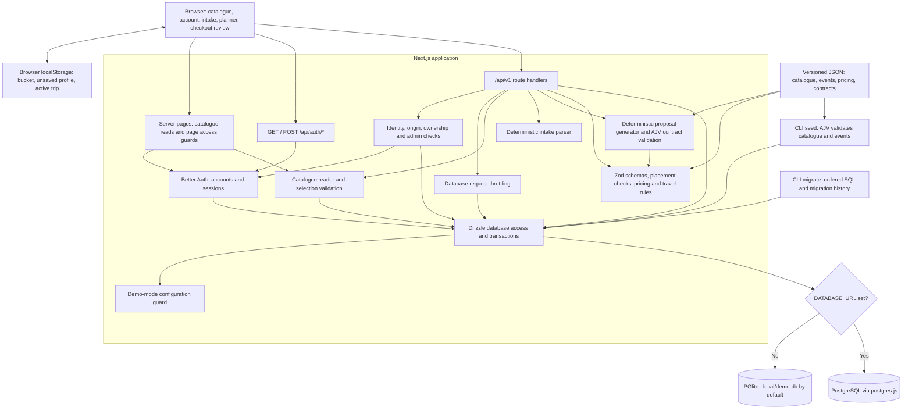
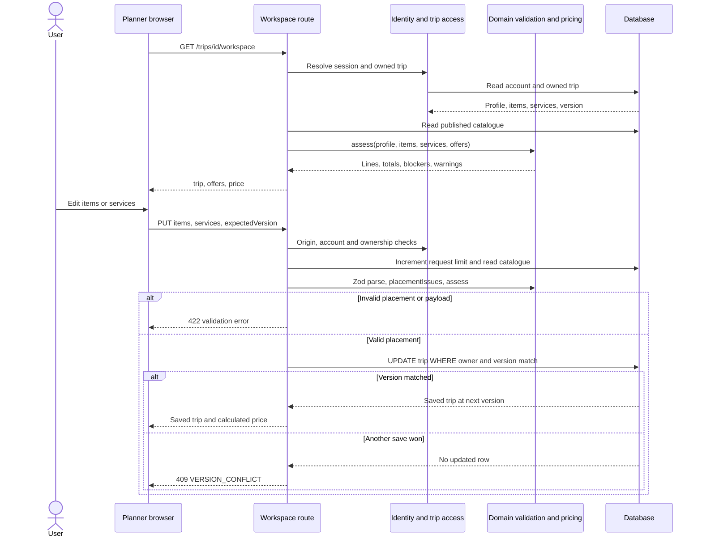
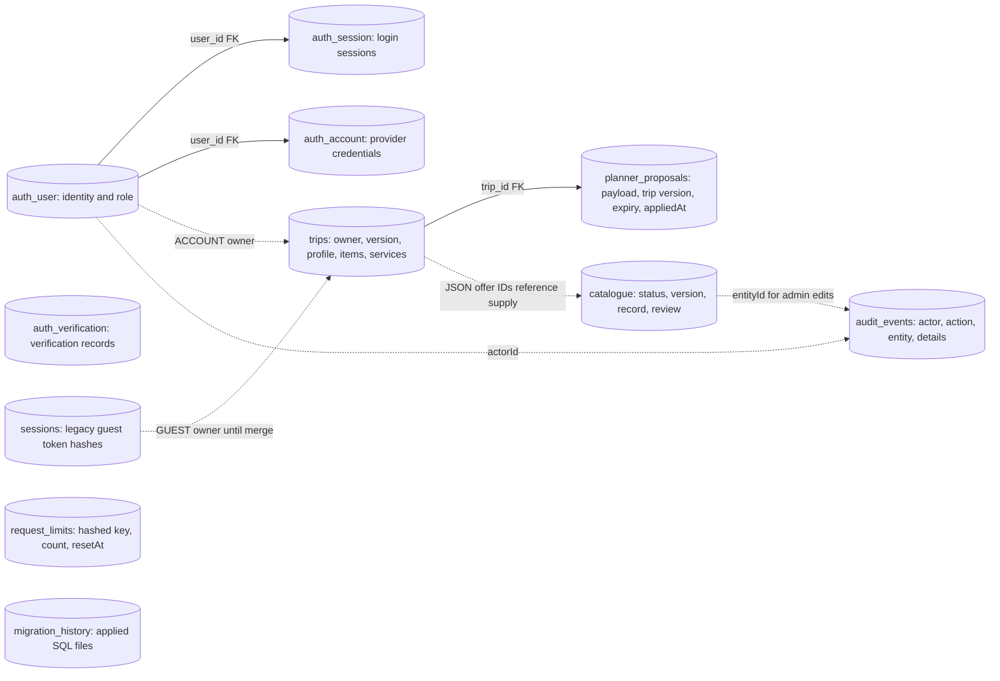

# Backend architecture

This guide describes the working tree as inspected on 2026-11-03, including current uncommitted implementation changes. It documents implemented behavior rather than the future V1 design in the handoff. Start with the component map, then follow the request flows below.

The backend is a **Next.js App Router application with an integrated backend**. HTTP route handlers, authentication, planning, validation and persistence run in the same application. There is one logical database, selected through Drizzle: local PGlite by default, or PostgreSQL when `DATABASE_URL` is set. There are no separate planner microservices, message queues or background workers in the current implementation.

## Component map

Arrows show calls or data movement. Boxes inside the application are code modules, not separate deployed services. Database arrows represent reads and writes unless labelled otherwise. The two storage engines are alternatives.



Standalone source: [backend-data-flow.mmd](backend-data-flow.mmd).

## Where each responsibility lives

Code is grouped by module (identity, catalogue, trips, bucket, audit), each split into domain, application, infrastructure and presentation layers; see [`src/modules/README.md`](../src/modules/README.md). Route files only map HTTP methods to controllers built in [`src/bootstrap/container.ts`](../src/bootstrap/container.ts).

| Component              | Responsibility                                                                                                                 | Source                                                                                                                                                                                                                                   |
| ---------------------- | ------------------------------------------------------------------------------------------------------------------------------ | ---------------------------------------------------------------------------------------------------------------------------------------------------------------------------------------------------------------------------------------- |
| HTTP API               | Parse requests, call guards and domain logic, coordinate database operations, return responses                                 | [`src/app/api`](../src/app/api)                                                                                                                                                                                                          |
| Authentication         | Email/password accounts, session creation/lookup, sign-out, trusted origins, auth-specific rate limiting                       | [`better-auth.ts`](../src/modules/identity/infrastructure/auth/better-auth.ts), [`auth route`](../src/app/api/auth/%5B...all%5D/route.ts)                                                                                                |
| Application identity   | Resolve account and current database role; reject unsigned planning; enforce trip ownership and admin access; format responses | [`request-guards.ts`](../src/modules/identity/presentation/http/request-guards.ts), [`resolve-actor.ts`](../src/modules/identity/application/use-cases/resolve-actor.ts), [`responses.ts`](../src/shared/presentation/http/responses.ts) |
| Page access            | Redirect unsigned users to account entry before rendering planning pages                                                       | [`page-guards.ts`](../src/modules/identity/presentation/pages/page-guards.ts)                                                                                                                                                            |
| Trip access            | Validate trip UUID, load an owned trip, parse stored profile/items/services                                                    | [`owned-trip.ts`](../src/modules/trips/presentation/http/owned-trip.ts), [`load-owned-trip.ts`](../src/modules/trips/application/use-cases/load-owned-trip.ts)                                                                           |
| Catalogue              | Read only `DEMO_PUBLISHED` supply; enrich records with photos and scheduling defaults                                          | [`experience.ts`](../src/modules/catalogue/domain/experience.ts), [`list-published-experiences.ts`](../src/modules/catalogue/application/use-cases/list-published-experiences.ts)                                                        |
| Selection              | Filter unpublished bucket ideas during creation; validate selections on updates and previews                                   | [`offer-selection.ts`](../src/modules/trips/application/services/offer-selection.ts)                                                                                                                                                     |
| Intake                 | Extract supported dates, party counts and interests from text; return a profile suggestion                                     | [`intake.ts`](../src/modules/trips/domain/intake.ts), [`profile.ts`](../src/modules/trips/domain/profile.ts)                                                                                                                             |
| Proposal generation    | Build an itinerary, retain locked/custom items, generate transfer blocks, validate the shared planner contract                 | [`proposal.ts`](../src/modules/trips/domain/proposal.ts)                                                                                                                                                                                 |
| Schedule and pricing   | Validate item/service shapes, assess placement, travel buffers, transport and guide requirements, calculate NGN totals         | [`planner.ts`](../src/modules/trips/domain/planner.ts)                                                                                                                                                                                   |
| Admin rules            | Validate catalogue edits and review requirements                                                                               | [`catalogue.ts`](../src/modules/catalogue/domain/catalogue.ts)                                                                                                                                                                           |
| Checkout presentation  | Group priced lines by day and identify unplanned days; no payment processing                                                   | [`checkout.ts`](../src/modules/trips/domain/checkout.ts)                                                                                                                                                                                 |
| Persistence            | Choose driver, share a process-level database instance, declare table mappings                                                 | [`client.ts`](../src/database/client.ts), [`schema.ts`](../src/database/schema.ts) (re-exports each module's `infrastructure/persistence/schema.ts`)                                                                                     |
| SQL compatibility      | Normalize raw SQL results from postgres.js arrays and PGlite `rows` objects                                                    | [`sql-rows.ts`](../src/database/sql-rows.ts)                                                                                                                                                                                             |
| Application throttling | Atomically increment hashed per-operation counters in `request_limits`                                                         | [`drizzle-rate-limiter.ts`](../src/modules/identity/infrastructure/persistence/drizzle-rate-limiter.ts), [`throttle-request.ts`](../src/modules/identity/application/use-cases/throttle-request.ts)                                      |
| Runtime guard          | Refuse non-demo mode, live checkout and production execution without an explicit local-demo override                           | [`environment.ts`](../src/config/environment.ts)                                                                                                                                                                                         |
| Setup and maintenance  | Apply SQL migrations, seed fictional supply, explicitly grant a local account the admin role                                   | [`scripts`](../scripts), [`migrations`](../migrations)                                                                                                                                                                                   |

Domain modules are shared with the browser for immediate feedback. API handlers independently enforce validation and calculate returned prices; browser state is not the persistence authority.

## API surface

Paths below are relative to `/api/v1`, except authentication. Trip access always includes an owner check. Route-specific validation order varies; there is no single middleware pipeline through which every request passes.

| Method    | Path                     | Access                                         | Input and result                                                                                                     |
| --------- | ------------------------ | ---------------------------------------------- | -------------------------------------------------------------------------------------------------------------------- |
| GET, POST | `/api/auth/*`            | Better Auth handler                            | Account and session operations using Better Auth's own protocol                                                      |
| GET       | `/experiences`           | Public                                         | Published demo catalogue                                                                                             |
| GET       | `/experiences/{id}`      | Public                                         | Published record by database UUID or `seedKey`; otherwise 404                                                        |
| POST      | `/intake`                | Account + origin check                         | `{ profile, message }` to suggested profile changes; does not save a trip                                            |
| GET       | `/trips`                 | Account                                        | Owned trips, newest update first                                                                                     |
| POST      | `/trips`                 | Account + origin check                         | Profile to a new trip; unavailable selected offers are filtered out                                                  |
| GET       | `/trips/{id}`            | Account + ownership                            | Stored draft                                                                                                         |
| PATCH     | `/trips/{id}`            | Account + ownership + origin check             | `{ expectedVersion, profile }`; validate against the existing schedule, synchronize assistance and increment version |
| GET       | `/trips/{id}/workspace`  | Account + ownership                            | `{ trip, offers, price }` with fresh assessment                                                                      |
| PUT       | `/trips/{id}/workspace`  | Account + ownership + origin check             | `{ expectedVersion, items, services }` to saved trip and calculated price                                            |
| POST      | `/trips/{id}/plan`       | Account + ownership + origin check             | Optional `selectedOfferIds` to persisted proposal, price, assumptions, questions and added/removed diff              |
| POST      | `/trips/{id}/plan/apply` | Account + ownership + origin check             | `{ proposalId, expectedVersion }`; atomically consume proposal and update trip                                       |
| POST      | `/account/merge`         | Account + origin check                         | Claim legacy guest drafts from the browser cookie; return merged count                                               |
| DELETE    | `/session`               | Origin check; account/guest session if present | Expire guest session, delete guest cookie and invoke account sign-out when applicable                                |
| GET       | `/admin/catalogue`       | Admin                                          | All catalogue records, including unpublished drafts                                                                  |
| POST      | `/admin/catalogue`       | Admin + origin check                           | Name to a fictional draft and audit event                                                                            |
| PATCH     | `/admin/catalogue`       | Admin + origin check                           | Versioned edit, review and status update with an audit event                                                         |

Application rate limits apply to intake (20), trip creation (20), trip writes (100), proposal generation (10), catalogue creation (15) and catalogue edits (60), each per actor and operation in a 60-second window. Profile and workspace writes share the trip-write counter. Merge and proposal application do not call the application limiter. Better Auth separately configures a 30-request/60-second auth limit; it does not use the application's `request_limits` helper.

## Data flow: browse, sign in and create a trip

1. Public catalogue requests call `listCatalogue()`, which reads published database records and adds display/scheduling defaults. Explore and experience server pages can call this directly without making an internal HTTP request.
2. Saving a bucket idea stores an offer ID in browser `localStorage`, not in a backend bucket table. An unsaved intake profile can also remain in the browser.
3. Planning pages use `requireSignedIn()`. API calls use `identity()`, which checks Better Auth's session and loads the account's current role from `auth_user`. Unsigned API planning requests receive 401.
4. The intake endpoint validates the profile and message, authenticates and throttles the caller, then runs the deterministic parser. Its suggested changes are returned for the user to review; this endpoint does not persist a profile or call an AI provider.
5. Creating a trip validates the profile, filters selected IDs against current published supply, and inserts an account-owned `trips` row at version 1. `items` starts empty and `services` starts with assistance and empty vehicle/guide selections.
6. The client opens the workspace, which returns the saved trip, published offers and a newly calculated assessment.

The legacy `sessions` table and `tourism-session` cookie support migration of older guest drafts. The current session route does not create new guest sessions. Guest merge atomically expires a valid guest session, transfers its trips to the signed-in account and records an audit event. Repeated claims cannot transfer the same guest drafts again.

## Data flow: edit and autosave



`expectedVersion` implements optimistic concurrency: a save only succeeds if the stored version still matches the client's version. A successful write increments it. The client must recover or reload after a conflict rather than overwrite another tab's changes.

`placementIssues()` enforces a subset of assessment blockers: invalid dates/times, unavailable offers, city/party/duration/opening/session/cutoff/capacity constraints, duplicates, overlaps, transit and full-day conflicts. Other assessment blockers, such as a missing accommodation base or service window, can remain in an editable saved draft and are returned with the price. A saved draft is not proof that it is bookable.

## Data flow: generate, preview and apply a plan

```mermaid
sequenceDiagram
    participant UI as Planner browser
    participant API as Plan routes
    participant Engine as Deterministic generator
    participant Rules as Contract and placement validation
    participant DB as Database

    UI->>API: POST /trips/id/plan
    API->>DB: Load owned trip, published offers and throttle counter
    API->>Engine: Profile, retained items, services, offers
    Engine->>Rules: Placement checks and AJV planner contract
    Engine-->>API: Items, services, assumptions, questions
    API->>DB: Insert proposal with trip version and 15-minute expiry
    API-->>UI: Proposal ID, expectedVersion, diff and price
    Note over UI,DB: Preview does not update the saved itinerary
    UI->>API: POST /plan/apply with proposalId and expectedVersion
    API->>DB: Load owned trip and current published offers
    API->>DB: BEGIN transaction
    API->>DB: Claim matching unexpired, unapplied proposal
    API->>Rules: Parse payload, check locked items, contract and placement
    API->>DB: Update owned trip only at expectedVersion
    alt All checks pass
        API->>DB: COMMIT proposal claim and trip update
        API-->>UI: Updated trip and fresh price
    else Expired, consumed, invalid, locked change or version conflict
        API->>DB: ROLLBACK
        API-->>UI: Error; regenerate preview or resolve invalid placement
    end
```

The generator retains locked items and custom blocks, filters eligible offers by city/interests/party, prioritizes selected offers and base zone, and tries to place experiences within available times. It uses conservative fictional zone travel data, light arrival/departure days and service windows. It validates generated items against the shared JSON Schema using AJV. It calls no external AI or routing service.

The proposal stores candidate items and services separately from the trip. Applying a proposal checks expiry, single use, matching trip/version, unchanged locked items and current placement validity. Claiming and updating occur in one transaction: a failed trip update rolls back the proposal's `appliedAt` change as well.

## Data flow: catalogue administration

An admin creates a fictional `DRAFT` from a fixture template, then edits its content, rates, capacity and review checklist. Normal review progression is `DRAFT` to `DEMO_VERIFIED` to `DEMO_PUBLISHED`; `PAUSED` removes a listing from public reads. This is a review workflow, not a comprehensive database-enforced state machine. The route requires completed review checks for verified/published states and a verification save before first publication.

Admin writes use a transaction to keep the catalogue mutation and `audit_events` insert together. Edits also require `expectedVersion`, returning 409 when stale. Public browsing, selection validation, assessments and proposal generation read the resulting published catalogue, so pausing or changing a record affects subsequent reads and calculations. Existing trips retain offer IDs rather than frozen catalogue/price snapshots.

The public signup flow cannot set an admin role. The explicit local [`grant-demo-admin.ts`](../scripts/grant-demo-admin.ts) script grants that role and records an audit event.

## Persistence model

Solid relationships below are database foreign keys. Dotted arrows are logical links enforced by application code, not foreign keys.



| Stored data       | Shape and authority                                                                                                                                                                                                                         |
| ----------------- | ------------------------------------------------------------------------------------------------------------------------------------------------------------------------------------------------------------------------------------------- |
| Trip              | `profile`, `items`, and `services` are JSONB; owner, version and update timestamp are columns. The owner ID/type pair is checked in application queries. There is no owner foreign key in the current migrations.                           |
| Catalogue         | Full experience/offer payload in JSONB, plus relational status, seed key, version and review JSONB. An experience database ID, fixture `seedKey` and nested offer ID are distinct identifiers. Planner items reference the nested offer ID. |
| Proposal          | Candidate JSONB payload, foreign key to trip, source trip version, expiry and application timestamp.                                                                                                                                        |
| Authentication    | Better Auth tables are separate from legacy guest `sessions`. Auth IDs are text; application trip ownership uses a UUID column. Better Auth is configured to generate UUID strings.                                                         |
| Audit             | Selected admin actions and guest merges, not a complete log of every trip edit or request.                                                                                                                                                  |
| Rate counters     | Database-backed counters keyed by SHA-256 of the operation/actor key.                                                                                                                                                                       |
| Migration history | SQL-managed table recording applied migration filenames; not declared in the Drizzle application schema.                                                                                                                                    |

Prices, assessment blockers and warnings are calculated on demand, not stored as immutable quotes. `assess()` combines trip profile, scheduled items, services, current published supply and [`pricing.demo.json`](../tourism-v1-handoff/data/pricing.demo.json). Activity, transport, cross-zone and guide lines use integer NGN minor units; fees use integer half-up rounding; current tax is zero. Hosted experiences and full-day guides suppress duplicate guide charges. Custom, break and travel blocks have no activity price.

## Responses and boundaries

Application API successes use `{ data, meta: { requestId } }` with `Cache-Control: private, no-store`. Failures use `{ error: { code, message }, meta: { requestId } }`. Better Auth's delegated routes use its own response format. Request IDs are generated response identifiers; the implementation does not establish end-to-end tracing or structured request logging.

Typical application statuses are 401 for missing authentication, 403 for origin/admin rejection, 404 for missing or non-owned trips, 409 for stale saves/proposals, 422 for malformed JSON or explicit input/domain failures, and 429 for throttling. Unhandled errors become a generic 503; an unexpected thrown schema error is not automatically translated to 422.

Writes call `checkOrigin()`. Its allowlist includes the configured origin, localhost/127.0.0.1 aliases for a local configuration, and an origin derived from the incoming Host header. Better Auth has its own trusted-origin configuration. Proxy/Host handling and production security still need review before any deployment.

Page guards improve navigation; API identity and ownership checks protect the data. The browser bucket, unsaved profile, active trip ID, presentation settings and unsaved edits are client state. They do not grant access to a trip.

## Runtime, setup and current limits

| Setting or tool                        | Effect                                                                                                                                     |
| -------------------------------------- | ------------------------------------------------------------------------------------------------------------------------------------------ |
| `DATABASE_URL`                         | When set, use PostgreSQL through postgres.js and Drizzle; otherwise use PGlite.                                                            |
| `LOCAL_DATABASE_PATH`                  | Override the PGlite directory; default `.local/demo-db`. One process must own the embedded database directory.                             |
| `PUBLIC_APP_URL`                       | Configure auth base URL and origin handling; default `http://127.0.0.1:3000`.                                                              |
| `AUTH_SECRET`                          | Supply auth secret; otherwise demo mode generates and persists `.local/auth-secret`.                                                       |
| `APP_MODE`, `LIVE_CHECKOUT_ENABLED`    | Database initialization rejects non-demo mode or live checkout.                                                                            |
| `ALLOW_LOCAL_DEMO_BUILD`               | Must be `true` for production-mode local demo execution; does not enable live operations.                                                  |
| `PAYMENT_PROVIDER`, `PLANNER_PROVIDER` | Listed in the environment example; no payment integration or runtime planner-provider switch is implemented. The planner is deterministic. |
| `npm.cmd run db:migrate`               | Apply ordered SQL migrations in transactions with an advisory lock and migration history.                                                  |
| `npm.cmd run db:seed:demo`             | Validate catalogue/event fixtures against JSON Schema and insert missing seed keys, preserving existing edits.                             |

Next.js loads `.env.local` for the app; CLI scripts read shell environment variables. Stop the local app before running migrations/seeds or copying the PGlite directory. PostgreSQL is the intended storage option for multiple app instances; production concurrency and operational readiness are not established by local embedded tests.

**Checkout currently ends at review.** The checkout component reads `/workspace` and displays calculated costs and readiness. There is no payment endpoint, booking/hold table, capacity reservation, provider webhook, refund pipeline, fulfilment service, supplier connection, email-delivery setup, live map/traffic integration or external AI connection. `inventoryHeld` is always false. Auth verification storage exists, but email verification is not required in the current auth configuration. These are implementation boundaries, not components hidden elsewhere in the backend.

## Maintaining this guide

Update this guide when changing routes, access rules, database tables, pricing authority or provider integrations. Keep the standalone component map synchronized with the first Mermaid block. The primary implementation references are [`src/app/api`](../src/app/api), [`src/modules`](../src/modules) (layering rules in its README), [`src/bootstrap/container.ts`](../src/bootstrap/container.ts), [`migrations`](../migrations) and [`scripts`](../scripts); handoff specifications describe planned behavior and may differ from the running implementation.
