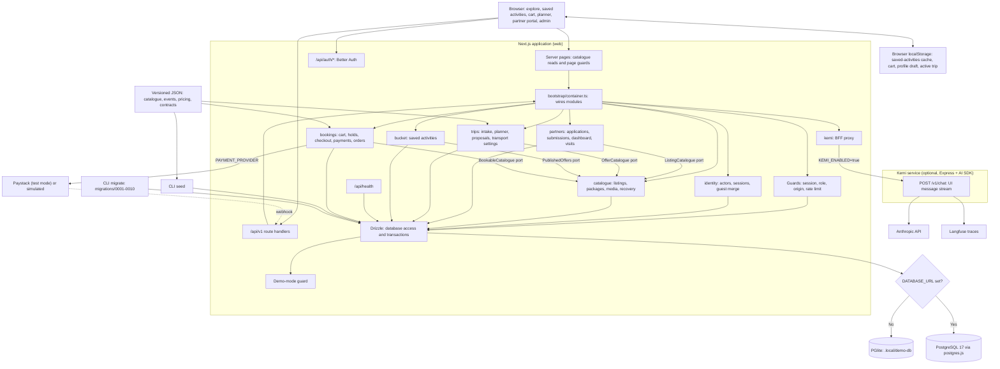
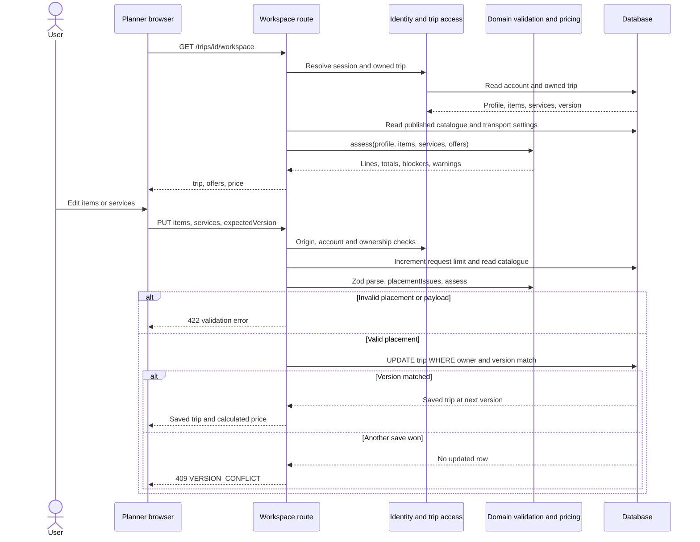
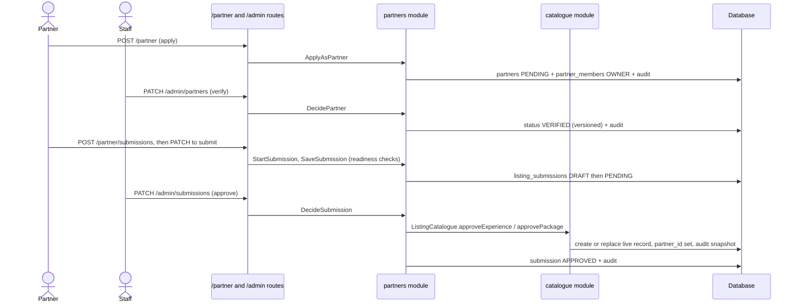
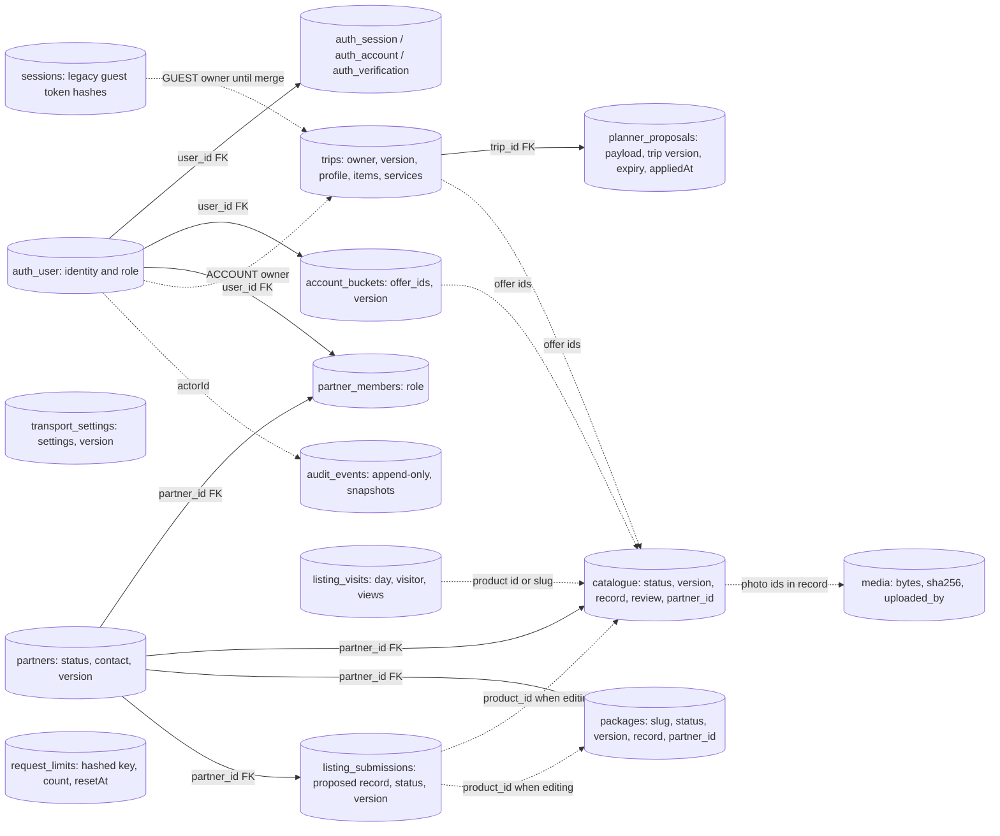

# Backend architecture

This guide describes the working tree on branch `kemi-agent` as inspected on
2026-11-24, including the uncommitted cart, checkout and payment stage. It documents what
is built, not the planned designs (payments, reviews storage, Kemi agents); those
are listed under [Not built yet](#not-built-yet). Start with the component map,
then follow the request flows.

The backend is a **Next.js App Router application with an integrated backend**.
Route handlers, authentication, planning, validation and persistence run in one
process. There is one logical database, reached through Drizzle: PGlite by
default, or PostgreSQL when `DATABASE_URL` is set (PostgreSQL 17 in Docker is
the recommended local setup). **Kemi**, the AI companion, is a second, optional
service in `services/kemi`, reached only through a proxy in the web app. There
are no queues, background workers or scheduled jobs.

## Component map

Arrows show calls or data movement. Boxes inside the web app are code modules,
not separate deployments. The two storage engines are alternatives.



Standalone source: [backend-data-flow.mmd](backend-data-flow.mmd).

## Modules

Code is grouped by module under [`src/modules`](../src/modules), each split into
`domain`, `application` (ports, use cases, services), `infrastructure` and
`presentation`; the rules are in [`src/modules/README.md`](../src/modules/README.md).
[`src/bootstrap/container.ts`](../src/bootstrap/container.ts) is the only place
that creates repositories and hands them to use cases and controllers. Route
files only map HTTP methods to `api.*` controllers; server pages call `pages.*`
directly, without an HTTP round trip. Modules reach each other only through
narrow ports built in the container (`OfferCatalogue`, `PublishedOffers`,
`ListingCatalogue`).

| Module      | Layers built                | Owns                                                                                                                                                 |
| ----------- | --------------------------- | ---------------------------------------------------------------------------------------------------------------------------------------------------- |
| `identity`  | all four                    | Better Auth setup, actor and role lookup, request guards, page guards, rate limiter, legacy guest sessions and draft merge                          |
| `catalogue` | all four                    | Experiences (listings), ready-made trips (packages), photo uploads, deletion and restore from the audit trail, publishing approved partner listings |
| `partners`  | all four                    | Partner applications and verification, membership, listing submissions and approval queue, partner dashboard, listing visit counts                  |
| `trips`     | all four                    | Trip profile and intake, planner workspace, proposals, transport and guide settings, trip checkout summary                                         |
| `bucket`    | all four                    | Saved activities per account (the UI calls them "saved activities"; the code and table still say bucket)                                            |
| `kemi`      | application, infra, presentation | Proxy to the Kemi service, behind a flag                                                                                                    |
| `audit`     | infrastructure (schema)     | The `audit_events` table, written by other modules' repositories                                                                                    |
| `bookings`  | all four                    | Server cart, line checks and pricing shared with the browser, capacity holds, checkout, payment providers, webhooks, orders and bookings          |
| `reviews`   | domain, application         | Review rules and use cases, tested with in-memory fakes. No tables, repository or routes                                                            |

Shared pieces: [`responses.ts`](../src/shared/presentation/http/responses.ts)
(response envelope and error mapping), [`app-error.ts`](../src/shared/application/app-error.ts),
[`database/client.ts`](../src/database/client.ts) (driver choice, lazy shared
instance), [`database/schema.ts`](../src/database/schema.ts) (re-exports each
module's `infrastructure/persistence/schema.ts`), [`sql-rows.ts`](../src/database/sql-rows.ts)
(normalises raw SQL results across postgres.js and PGlite) and
[`config/environment.ts`](../src/config/environment.ts).

Domain code is shared with the browser for instant feedback. API handlers
re-validate and recalculate prices themselves; browser state is never the
authority: checkout reprices every cart line on the server.

## Access rules

| Guard                  | Where                                                                          | Rule                                                                                                                         |
| ---------------------- | ------------------------------------------------------------------------------ | ---------------------------------------------------------------------------------------------------------------------------- |
| `requireActor()`       | [`request-guards.ts`](../src/modules/identity/presentation/http/request-guards.ts) | Signed-in account, else 401. Resolves the account's current role from `auth_user`.                                       |
| `requireAdmin()`       | same                                                                           | Role `ADMIN` or `SUPER_ADMIN`, else 403.                                                                                     |
| `requireSuperAdmin()`  | same                                                                           | Role `SUPER_ADMIN`; only used to delete listings.                                                                            |
| `PartnerAccess.verified()` | [`partner-access.ts`](../src/modules/partners/application/services/partner-access.ts) | Account is a member of a `VERIFIED` partner, else 403 `NOT_A_PARTNER` / `PARTNER_NOT_VERIFIED`. Every partner query is scoped to that partner's id. |
| Trip ownership         | [`owned-trip.ts`](../src/modules/trips/presentation/http/owned-trip.ts)        | Trip UUID must belong to the actor; otherwise 404, so other users' trips are indistinguishable from missing ones.             |
| `checkOrigin()`        | request guards                                                                 | Every write. `Origin` must be `PUBLIC_APP_URL`, its localhost/127.0.0.1 alias, or the request's own Host.                     |
| `throttle(key, max)`   | request guards → `request_limits`                                              | Per actor and operation, 60-second window, stored in the database so it holds across replicas.                               |
| Page guards            | [`page-guards.ts`](../src/modules/identity/presentation/pages/page-guards.ts)  | `requireSignedIn(next)` redirects to `/account?next=…`. Used by `/checkout`, `/partner`, `/plan/new`, `/trips/**`. `/admin` checks `requireAdmin` itself. |

Page guards are for navigation; the API checks are what protect data. Partner
membership is a separate table, not a role, so one account can be a traveller
and a partner. Public sign-up never sets a role; `scripts/grant-demo-admin.ts`
does, with an audit event.

## API surface

Paths are relative to `/api/v1` unless they start with `/api`. "Origin" means
`checkOrigin()` runs. Limits are requests per actor per 60 seconds.

**Platform and identity**

| Method    | Path              | Access                       | Does                                                                     |
| --------- | ----------------- | ---------------------------- | ------------------------------------------------------------------------ |
| GET, POST | `/api/auth/*`     | Better Auth                  | Sign-up, sign-in, sessions (Better Auth's own protocol, 30 req/60 s)     |
| GET       | `/api/health`     | Public                       | `SELECT 1`; `{status:"ok"}` or 503. Never cached                        |
| DELETE    | `/session`        | Origin                       | Expires the legacy guest session and signs the account out               |
| POST      | `/account/merge`  | Account + origin             | Moves legacy guest **trip drafts** to the account                        |

**Catalogue (public)**

| Method | Path                | Access | Does                                                                         |
| ------ | ------------------- | ------ | ---------------------------------------------------------------------------- |
| GET    | `/experiences`      | Public | Published listings (`DEMO_PUBLISHED`)                                        |
| GET    | `/experiences/{id}` | Public | One published listing by UUID or seed key                                    |
| GET    | `/packages`         | Public | Published ready-made trips                                                   |
| GET    | `/media/{id}`       | Public | Uploaded photo bytes; immutable cache, `nosniff`, sandboxed CSP              |
| POST   | `/views`            | Origin, 120 per visitor | Counts a listing view; staff and partner members aren't counted |

**Traveller**

| Method     | Path                     | Access                             | Does                                                                                   |
| ---------- | ------------------------ | ---------------------------------- | -------------------------------------------------------------------------------------- |
| GET, PUT   | `/bucket`                | Account (PUT: origin, 60)          | Saved activities, `{offerIds, expectedVersion}`, max 30; unpublished ids dropped       |
| POST       | `/intake`                | Account + origin, 20               | Text → suggested profile changes; saves nothing                                        |
| GET, POST  | `/trips`                 | Account (POST: origin, 20)         | List owned trips; create one from a profile                                            |
| GET, PATCH, DELETE | `/trips/{id}`    | Owner (writes: origin, 100)        | Read, update profile with `expectedVersion`, delete                                    |
| GET, PUT   | `/trips/{id}/workspace`  | Owner (PUT: origin, 100)           | Items, services and fresh price; versioned save                                        |
| POST       | `/trips/{id}/plan`       | Owner + origin, 10                 | Generate a proposal (15-minute expiry)                                                 |
| POST       | `/trips/{id}/plan/apply` | Owner + origin                     | Apply a proposal atomically                                                            |
| GET, POST  | `/kemi/{...path}`        | Account (POST: origin), 60; `KEMI_ENABLED` | Forwards to Kemi `/v1/...`; 404 `KEMI_DISABLED` when off                       |

**Cart, checkout and payment**

| Method   | Path                               | Access                                    | Does                                                                                                     |
| -------- | ---------------------------------- | ----------------------------------------- | -------------------------------------------------------------------------------------------------------- |
| GET, PUT | `/cart`                            | Account (PUT: origin, 60)                 | Saved cart, `{lines, expectedVersion}`, max 20 lines; 409 when another device saved first              |
| POST     | `/cart/quote`                      | Account + origin, 60                      | Server price, problems and places left per line; stores nothing                                          |
| POST     | `/checkouts`                       | Account + origin, 10; `Idempotency-Key`   | Reprice, hold places for 15 minutes, open a payment; returns the payment page URL                        |
| POST     | `/payments/paystack/webhook`       | Paystack signature only                   | Stores the event and confirms `charge.success`; 401 on a bad signature, 500 so Paystack retries a failure |
| POST     | `/payments/verify`                 | Account + origin, 30; own payment         | The return page asking again while a payment is pending                                                  |
| POST     | `/payments/simulated`              | Account + origin, 20; own payment         | The local payment page's buttons; only with `PAYMENT_PROVIDER=simulated`                                 |
| GET      | `/orders`, `/orders/{reference}`   | Account; own orders only                  | Paid orders with their bookings                                                                          |

Pages: `/checkout/return` (confirms the payment, then redirects to the
order), `/checkout/simulated`, `/bookings` (My bookings, also in the Trips
menu) and `/bookings/{reference}`.

**Partner portal**

| Method             | Path                    | Access                          | Does                                                                         |
| ------------------ | ----------------------- | ------------------------------- | ---------------------------------------------------------------------------- |
| GET, POST          | `/partner`              | Account (POST: origin, 10)      | Own partner record; apply (creates `PENDING` partner, caller as `OWNER`)     |
| GET                | `/partner/listings`     | Verified partner                | Own live listings and trips, with any open submission                        |
| POST, PATCH, DELETE | `/partner/submissions` | Verified partner + origin (30 / 60 / 60) | Start a draft (new or edit of live), save/submit, withdraw          |
| GET                | `/partner/dashboard`    | Verified partner                | Listing counts by status and views/visitors from `listing_visits`            |
| POST               | `/partner/media`        | Verified partner + origin, 60   | Photo upload, same rules as staff upload                                     |

**Admin**

| Method                  | Path                          | Access                          | Does                                                                                 |
| ----------------------- | ----------------------------- | ------------------------------- | ------------------------------------------------------------------------------------ |
| GET, POST, PATCH, DELETE | `/admin/catalogue`           | Admin (DELETE: super admin); origin on writes; 15 create / 60 edit / 20 delete | All listings; create draft; versioned edit and review; delete (snapshot kept in audit) |
| GET, POST               | `/admin/catalogue/deleted`    | Admin (POST: origin, 20)        | Deleted listings from the audit trail; restore one                                   |
| GET                     | `/admin/catalogue/history`    | Admin                           | Saved versions of a listing                                                          |
| GET, POST, PATCH        | `/admin/packages`             | Admin; origin on writes; 15 / 60 | Ready-made trips: list, create draft, versioned edit                                |
| POST                    | `/admin/media`                | Admin + origin, 60              | Photo upload (max 5 MB, type checked, deduplicated by SHA-256)                       |
| GET, PATCH              | `/admin/partners`             | Admin (PATCH: origin, 60)       | Partners; verify, decline or suspend with a reason                                   |
| GET, PATCH              | `/admin/submissions`          | Admin (PATCH: origin, 60)       | Pending submissions with the live version; approve (publishes) or decline            |
| GET, PUT                | `/admin/transport-settings`   | Admin (PUT: origin, 30)         | Car, night-car and guide rates and rules the planner reads                           |

Successes are `{ data, meta: { requestId } }` with `Cache-Control: private,
no-store`; failures are `{ error: { code, message }, meta: { requestId } }`.
Typical statuses: 401 unauthenticated, 403 origin/role/partner rejection, 404
missing or not owned, 409 `VERSION_CONFLICT`, 422 invalid input, 429 throttled.
Unhandled errors become a generic 503. Request ids are per response; there is
no tracing or structured logging in the web app.

## Data flow: browse, save and sign in

1. Explore, listing and package pages read the published catalogue through
   `pages.listPublishedExperiences()` / `listPublishedPackages()`; the browser
   also calls `/experiences` and `/packages`.
2. **Saved activities.** Guests keep offer ids in localStorage. Signed in,
   [`use-bucket-sync.ts`](../src/hooks/use-bucket-sync.ts) loads `/bucket`, merges
   the guest list after the account's (`mergeBuckets`, max 30), and saves with
   `expectedVersion`. localStorage stays the cache, with owner and pending keys
   so another account's list is never shown and offline changes are retried.
3. **Cart.** Lines (dated experience or package, party, pickup; max 20) are
   cached in localStorage like saved activities. Signed in,
   [`use-cart-sync.ts`](../src/hooks/use-cart-sync.ts) keeps them in
   `account_carts` through `/cart`. At sign-in the guest cart merges in
   (`mergeCarts`: a guest line replaces the account line for the same product,
   date and start). The cart page checks each line with `resolveLine`, the
   same function the server uses at checkout.
4. Sign-out (`DELETE /session` and `forgetTravellerState()`) first saves
   pending bucket and cart changes, then clears every traveller key in
   localStorage; both come back from the server at the next sign-in.
5. Planning pages require sign-in. Creating a trip validates the profile,
   drops selected offers that are no longer published, and inserts an
   account-owned `trips` row at version 1.

The legacy `sessions` table and `tourism-session` cookie only exist so older
guest trip drafts can be claimed; no new guest sessions are created. The merge
expires the guest session, moves its trips and writes an audit event in one
transaction.

## Data flow: cart, checkout and payment

```mermaid
sequenceDiagram
    actor T as Traveller
    participant UI as Checkout page
    participant API as /api/v1
    participant B as bookings module
    participant DB as Database
    participant P as Paystack (or simulated)

    UI->>API: POST /cart/quote (lines)
    API->>B: CartPricing: resolveLine + places left
    B-->>UI: Prices, problems, "2 places left"
    T->>UI: Pay
    UI->>API: POST /checkouts + Idempotency-Key + shown total
    API->>B: StartCheckout
    B->>B: Reprice; refuse PRICE_CHANGED or LINE_UNAVAILABLE
    B->>DB: BEGIN; lapse own old holds; upsert slots; lock in id order; check; insert HELD checkout; COMMIT
    B->>P: initialize(reference, amount, email, callback)
    B->>DB: payments INITIALISED, checkout PAYMENT_PENDING
    B-->>UI: Payment page URL
    T->>P: Pays
    P-->>API: webhook charge.success (signed)
    P-->>UI: Redirect to /checkout/return?reference=
    Note over API,B: Webhook and return page both call ConfirmPayment
    B->>P: verify(reference)
    B->>DB: BEGIN; lock payment and checkout; order, one booking per line, history, audit; remove paid lines from cart; COMMIT
    UI->>T: /bookings/FL-XXXXXX
```

- **One function for line checks.** `resolveLine` (`bookings/domain/resolve-line.ts`)
  checks the date, start time and cutoff, party size, child ages, minimum age,
  pickup address and package departure, and prices the line. The cart page,
  the quote and checkout all call it, so the browser and server agree.
- **Places.** `inventory_slots` has one row per sellable start: per session
  for fixed listings, per day (`DAY`) for drop-in listings and trips (D3).
  Capacity comes from the listing (`capacityPerSlot`, or the session's own
  capacity) or from the departure's new `capacity` field (D2). A departure
  without one sells a sample 12 places when `OPEN` and 4 when `LIMITED`.
  Places taken = bookings that still hold places + lines of
  `HELD`/`PAYMENT_PENDING` checkouts whose `expires_at` is still ahead, so a
  hold lapses on its own.
- **Only sellable products.** The container's `BookableCatalogue` returns
  published listings and trips run by Fastlife or by a `VERIFIED` partner.
- **Idempotency.** A repeated `Idempotency-Key` continues the same checkout:
  it returns the same payment page, or opens one if the provider was down
  last time (the hold is kept; the error was 503 `PAYMENT_PROVIDER_UNAVAILABLE`).
  The same key arriving twice at the same instant is caught at the
  `UNIQUE` constraint and answered with the first request's checkout, and
  attaching a payment is first-wins under the checkout row lock, so one
  checkout never has two payment pages.
- **Concurrency.** Holding and settling both lock the slot rows
  (`SELECT … FOR UPDATE`, in id order) before counting places, so buyers
  of the same slot are serialised. Settling re-checks capacity under those
  locks even when the hold still looks valid, because a hold can lapse and
  its places be taken in the moment before the payment is confirmed.
  `npm run test:postgres` (with `TEST_POSTGRES_URL`) proves this on real
  PostgreSQL with many connections: 25 buyers for one place get exactly one
  hold, and buyers paying at once never book more than the places.
- **ConfirmPayment** is safe to repeat. It verifies with the provider and
  sends a wrong amount or currency to `REQUIRES_REVIEW`. An abandoned payment
  page stays pending while the hold lasts. A failed payment fails the
  checkout, which frees its places. A payment that arrives after its hold
  lapsed is booked only if its places are still free; otherwise the checkout
  becomes `REQUIRES_REVIEW` (`CAPACITY_LOST`) and nothing is oversold.
- **Bookings** start `CONFIRMED` for instant listings, and
  `AWAITING_PARTNER` with a `partner_deadline` for partner-confirmed listings
  and every trip (48 h). Partner bookings copy a sample 15% commission
  (`defaultCommissionBps`).
- **Webhook.** The raw body's HMAC-SHA512 must match `x-paystack-signature`.
  Each body is stored in `payment_events` by its SHA-256, so a repeat delivery
  is ignored and an event whose processing failed is handled again.
- **Providers.** `PAYMENT_PROVIDER=paystack` needs `PAYSTACK_SECRET_KEY`
  starting `sk_test_`. `simulated` serves `/checkout/simulated` in the app
  instead of Paystack, keeps attempts in memory (a restart forgets unfinished
  ones), and is refused in production. `disabled` (the default) keeps Pay off.
- **Notifications** only log (`LogNotifier`, D8); the audit trail records
  `ORDER_PAID` and `CHECKOUT_REQUIRES_REVIEW`.

## Data flow: edit and autosave



`expectedVersion` is optimistic concurrency: a save succeeds only if the stored
version still matches, and increments it. The client reloads after a conflict
rather than overwriting another tab's changes. The same pattern is used for
saved activities, listings, packages, partners, submissions and transport
settings.

`placementIssues()` enforces a subset of assessment blockers: invalid
dates/times, unavailable offers, city/party/duration/opening/session/cutoff/capacity
constraints, duplicates, overlaps, transit and full-day conflicts. Other
blockers, such as a missing accommodation base or service window, can remain
in a saved draft and are returned with the price. A saved draft is not proof
that it is bookable.

## Data flow: generate, preview and apply a plan

```mermaid
sequenceDiagram
    participant UI as Planner browser
    participant API as Plan routes
    participant Engine as Deterministic generator
    participant Rules as Contract and placement validation
    participant DB as Database

    UI->>API: POST /trips/id/plan
    API->>DB: Load owned trip, published offers and throttle counter
    API->>Engine: Profile, retained items, services, offers
    Engine->>Rules: Placement checks and AJV planner contract
    Engine-->>API: Items, services, assumptions, questions
    API->>DB: Insert proposal with trip version and 15-minute expiry
    API-->>UI: Proposal ID, expectedVersion, diff and price
    Note over UI,DB: Preview does not update the saved itinerary
    UI->>API: POST /plan/apply with proposalId and expectedVersion
    API->>DB: Load owned trip and current published offers
    API->>DB: BEGIN transaction
    API->>DB: Claim matching unexpired, unapplied proposal
    API->>Rules: Parse payload, check locked items, contract and placement
    API->>DB: Update owned trip only at expectedVersion
    alt All checks pass
        API->>DB: COMMIT proposal claim and trip update
        API-->>UI: Updated trip and fresh price
    else Expired, consumed, invalid, locked change or version conflict
        API->>DB: ROLLBACK
        API-->>UI: Error; regenerate preview or resolve invalid placement
    end
```

The generator keeps locked items and custom blocks, filters eligible offers by
city, interests and party, prioritises selected offers and the base zone, and
places experiences within available times. It uses fictional zone travel data
and the admin-set transport settings, and validates output against the shared
JSON Schema with AJV. It calls no AI or routing service.

## Data flow: catalogue administration

- **Listings.** Staff create a fictional `DRAFT`, then edit content, rates,
  capacity, schedule, photos and the review checklist. Statuses: `DRAFT`,
  `RESEARCHED`, `DEMO_VERIFIED`, `DEMO_PUBLISHED`, `PAUSED`; only
  `DEMO_PUBLISHED` is public. Verified and published states require the review
  checks. A listing that runs past midnight also needs the night-visit
  security review before it can be verified or published.
- **Packages** (ready-made trips): `DRAFT`, `DEMO_PUBLISHED`, `PAUSED`, with
  departures marked `OPEN`/`LIMITED`/`FULL` (no seat numbers). The slug is fixed
  at creation because cart lines refer to it.
- **Audit and recovery.** Every listing write inserts an `audit_events` row
  with a full snapshot, in the same transaction; package writes are audited
  too. Migration 0008 makes
  `audit_events` append-only with triggers, and refuses drop/alter unless a
  developer sets `app.allow_audit_ddl` in a console. Deleting a listing (super
  admin) leaves its snapshot; admins list deleted listings and restore them, and
  read a listing's version history, from those events.
- **Photos** are stored as `bytea` in `media`, deduplicated by SHA-256, never
  deleted, so a restored listing gets its photos back. The app writes nothing
  to disk.

Existing trips keep offer ids, not snapshots, so a changed or paused listing
affects their next price and assessment.

## Data flow: partner portal



The catalogue only ever holds what staff approved. An edit to a live listing
waits as a submission while the live version keeps selling; a unique index
allows one open submission per listing. Approval re-checks that the partner is
still `VERIFIED` and that the submission version hasn't changed since staff
opened it. A listing staff paused stays paused after an approved edit. Details:
[PARTNER_PORTAL.md](PARTNER_PORTAL.md).

## Kemi

Kemi is a separate Node service ([`services/kemi`](../services/kemi), Express 5,
AI SDK 7, Anthropic models, Langfuse tracing over OpenTelemetry). It has
`POST /v1/chat`, which streams the AI SDK UI message stream, and a health
route. The browser never calls it directly: `/api/v1/kemi/*` checks the flag,
session, origin (on POST), rate limit, path segments and a 256 KB body cap,
then forwards with a fresh request id. Cookies and caller headers are not
forwarded, and no user identity is sent yet (ADR 0002 phase 0). Kemi has no
access to app data: the on-behalf-of token and `/internal/kemi/*` tool API in
[KEMI_ARCHITECTURE.md](KEMI_ARCHITECTURE.md) are not built.

## Persistence model

Solid arrows are foreign keys; dotted arrows are links the application enforces.



| Migration | Adds                                                                                                  |
| --------- | ----------------------------------------------------------------------------------------------------- |
| 0001      | `catalogue`, `trips`, `sessions` (guest), `migration_history`                                         |
| 0002      | Better Auth tables (`auth_*`, with role), trip owner type, `audit_events`, `request_limits`           |
| 0003      | Catalogue review checklist                                                                             |
| 0004      | `planner_proposals`                                                                                    |
| 0005      | `account_buckets`                                                                                      |
| 0006      | `transport_settings`                                                                                   |
| 0007      | `packages`                                                                                             |
| 0008      | Append-only `audit_events` triggers, starting snapshot of every listing, `media`                      |
| 0009      | `partners`, `partner_members`, `partner_id` on catalogue and packages, `listing_submissions`, `listing_visits` |
| 0010      | `account_carts`, `inventory_slots`, `checkouts`, `checkout_lines`, `orders`, `bookings`, `booking_status_history`, `payments`, `payment_events` |

Listings, packages, trips and submissions keep the full record in JSONB, with
status, version and owner/partner as columns. Experience database id, seed
key and nested offer id are different identifiers; trips, saved activities and
cart lines refer to the offer id. Money is integer kobo throughout. Prices are
calculated on demand from the catalogue, transport settings and
[`pricing.demo.json`](../tourism-v1-handoff/data/pricing.demo.json) (fee rate);
nothing stores a quote.

## Runtime and deployment

| Setting or tool                     | Effect                                                                                                             |
| ----------------------------------- | ------------------------------------------------------------------------------------------------------------------ |
| `DATABASE_URL`                      | PostgreSQL through postgres.js; empty means PGlite at `LOCAL_DATABASE_PATH` (default `.local/demo-db`, one process only). |
| `npm run db:up`                     | Local PostgreSQL 17 in Docker on `127.0.0.1:5440` ([LOCAL_DATABASE.md](LOCAL_DATABASE.md)).                         |
| `PUBLIC_APP_URL`                    | Auth base URL and origin allowlist; default `http://127.0.0.1:3000`.                                               |
| `AUTH_SECRET`                       | Required in production; demo mode otherwise generates `.local/auth-secret`.                                        |
| `APP_MODE`, `LIVE_CHECKOUT_ENABLED` | `assertDemo()` refuses anything but demo mode and refuses live checkout.                                           |
| `ALLOW_LOCAL_DEMO_BUILD`            | Must be `true` to run under `NODE_ENV=production` (set in Compose).                                               |
| `KEMI_ENABLED`, `KEMI_URL`          | Opens the Kemi proxy only when exactly `true`; default URL `http://127.0.0.1:4100`.                                |
| `PAYMENT_PROVIDER`, `PAYSTACK_SECRET_KEY` | `disabled` (default), `simulated` (local only) or `paystack` (test keys only); see the checkout flow above. |
| `PLANNER_PROVIDER`                  | Listed in `.env.example` but read by nothing; the planner is deterministic.                                     |
| `npm run db:migrate` / `db:seed:demo` / `db:refresh-dates` | Ordered SQL migrations under an advisory lock; fictional seed (AJV-validated, keeps edits); move demo dates forward. |

**Docker** (uncommitted, not yet built or deployed; see [DEPLOYMENT.md](DEPLOYMENT.md)):
`next.config.ts` builds `output: "standalone"`. `docker-compose.prod.yml` runs
`db` (PostgreSQL 17), a one-off `migrate` job, `web` (starts only after
`migrate` succeeds, health-checked on `/api/health`) and, under the `kemi`
profile, `kemi` on the internal network only. The web app is stateless, so it
can be replaced or scaled; rate limits already live in the database.

**Tests.** `npm test` runs Vitest suites in [`tests`](../tests) (domain, components,
partners, reviews use cases, Kemi proxy). `test:modules` runs use cases
against the real database; `test:integration`, `test:admin`, `test:workspace`
and `test:overlays` drive a running app. `test:postgres` runs the
concurrent checkout tests against PostgreSQL in a throwaway database it
creates and drops; it is skipped unless `TEST_POSTGRES_URL` is set.

## Not built yet

These are boundaries, not components hidden elsewhere:

- **After payment:** the reconciler (expiring pending payments, auto-declining
  missed partner deadlines, completing bookings), partner and staff
  confirm/decline queues, refunds and the `refunds` table, partner payouts,
  and a staff view of `REQUIRES_REVIEW` checkouts. Until then, a partner
  booking stays `AWAITING_PARTNER` past its deadline. Plans:
  [CART_END_TO_END.md](CART_END_TO_END.md),
  [PAYMENT_INTEGRATION_PLAN.md](PAYMENT_INTEGRATION_PLAN.md).
- **Live payments.** Paystack runs in test mode only and hasn't been tried
  with real test keys yet. Docker Compose keeps `PAYMENT_PROVIDER: disabled`.
- **Trip checkout** (`/trips/{id}/checkout`) shows calculated costs and
  readiness only; `inventoryHeld` is always false.
- **Reviews**: domain and use cases only; no tables, routes or UI wiring
  ([REVIEWS_PLAN.md](REVIEWS_PLAN.md)).
- **Kemi** tools, memory and user identity ([KEMI_ARCHITECTURE.md](KEMI_ARCHITECTURE.md)).
- **Background jobs** of any kind (hold expiry, reconciliation, completing
  bookings), email or WhatsApp delivery, supplier connections, live maps or
  traffic.
- Email verification is stored by Better Auth but not required.
- Production review of proxy and Host handling for `checkOrigin()`.

## Maintaining this guide

Update it when changing routes, access rules, tables, pricing authority or
provider integrations, and keep [backend-data-flow.mmd](backend-data-flow.mmd) in
step with the first diagram. The sources of truth are
[`src/app/api`](../src/app/api), [`src/bootstrap/container.ts`](../src/bootstrap/container.ts),
[`src/modules`](../src/modules), [`migrations`](../migrations) and
[`scripts`](../scripts). The handoff specifications describe planned behaviour
and may differ from the running app.
