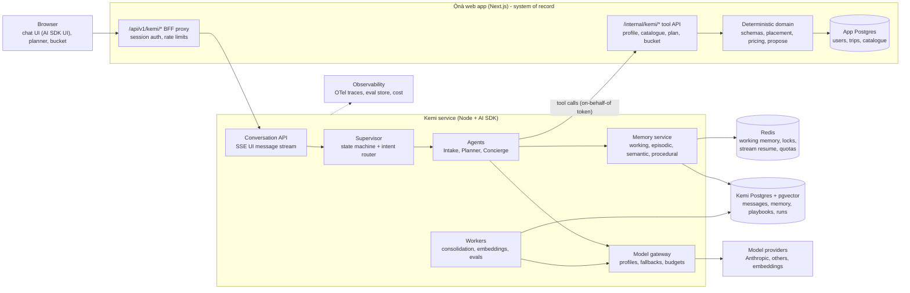
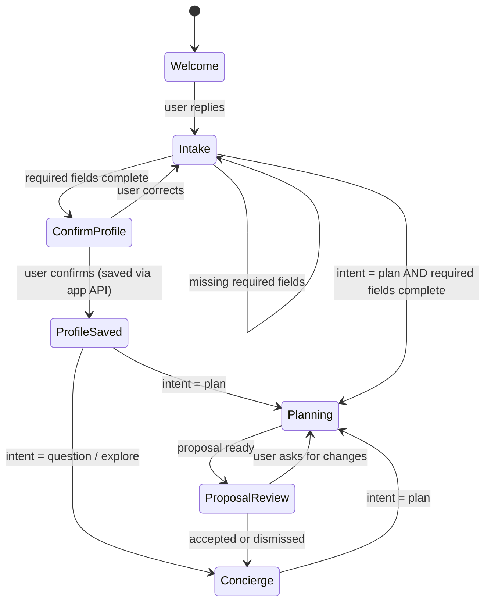

# Kemi — production architecture plan

Status: proposal, 2026-11-09. Kemi is Ọ̀nà's AI trip companion. This document plans Kemi as a **separate service** built on the Vercel AI SDK (v7). It covers orchestration, agents, memory, the model gateway and LLM operations. It does not change the web app's existing contracts. Kemi calls them.

## 1. Goals and non-goals

**Goals**

1. **Persona intake.** Welcome the user and hold a natural conversation (text or voice). Fill every field of the trip profile schema, and capture everything else useful as structured metadata.
2. **Planning handoff.** When the user asks Kemi to plan, hand off to a planner orchestrator. It reads the profile, bucket and existing itinerary. It finds experiences and itinerary patterns that match ("rhyme with") the persona, proposes a schedule for the user's calendar, and adds more options to the bucket.
3. **Memory.** Keep working memory for the current session, the user's past conversations, semantic facts about the user, and procedural memory (Kemi's playbooks plus the user's own standing preferences).
4. **Model choice.** Use model profiles, so any task can run on any provider's model and can fall back, be budgeted and be swapped without code changes.
5. **Production-grade operations.** Tracing, evals, prompt versioning, cost control, guardrails and a kill switch.

**Non-goals**

- Kemi never books, pays or applies an itinerary on its own. It proposes. The user accepts through the web app's existing endpoints.
- Kemi is not the source of truth for trips, prices or availability. The web app's deterministic domain code is.

## 2. Guiding principles

- **Deterministic core, AI edge.** Validation, pricing, placement and availability stay in the web app's tested code: `profileSchema`, `placementIssues`, `assess`, `propose`. Models choose and explain. Code decides what is valid.
- **Code routes, models converse.** A small state machine decides which agent is active. An LLM never decides alone whether to plan, save or apply.
- **Everything a model writes is a proposal.** Profile patches, memory facts and plans are validated, versioned and shown to the user before they count.
- **Memory is user-owned.** Every stored fact can be traced to its source message, and the user can view and delete it.
- **Every prompt and model choice is versioned and evaluated** before rollout.

## 3. System context



### Service boundary

| Concern | Owner |
|---|---|
| Accounts, sessions, authorization | Web app |
| Trip profile, items, bucket, prices, availability | Web app (Kemi reads and writes via the tool API only) |
| Conversations, memory, playbooks, agent runs | Kemi |
| Catalogue embeddings, itinerary-pattern embeddings | Kemi (rebuilt from the web app's catalogue events) |

### Auth between services

1. The browser talks only to the web app. The `/api/v1/kemi/*` BFF route checks the session (`identity()`, `checkOrigin()`, existing limits).
2. The BFF mints a **short-lived on-behalf-of token** (signed JWT, about 5 minutes) with `sub=userId`, `tripId`, `scopes` (for example `profile:write`, `plan:propose`, `bucket:write`) and a request ID. It forwards the request and pipes Kemi's stream back.
3. Kemi presents that token on every `/internal/kemi/*` call. The web app re-checks ownership. Kemi never holds broad database credentials for app data.
4. Kemi to app traffic is private-network only, with mTLS or a shared signing key that is rotated.

## 4. Orchestration

### 4.1 Conversation state machine (Supervisor)

The Supervisor is code, not an LLM. Each turn it loads the session state and runs a cheap intent classifier (structured output, small model). Then it activates exactly one agent.



Rules:

- **The planning gate is deterministic:** all required fields are valid and the user has confirmed the summary. If the user asks to plan early, Kemi asks for the missing items instead (Intake stays active).
- An intent can only trigger a transition the state machine allows.
- State lives in working memory (Redis), with a snapshot in Postgres per turn, so a lost stream or a restarted pod resumes cleanly.

### 4.2 Handoff contract

A handoff is a state transition plus a typed **handoff packet**. The receiving agent never re-reads the raw transcript to work out what happened.

```ts
// Shared Zod schema (package: @ona/kemi-contracts)
HandoffPacket = {
  from: "intake" | "concierge" | "planner",
  to: "planner" | "concierge" | "intake",
  tripId: string,
  profileVersion: number,          // web app trip version
  goal: string,                    // e.g. "Plan days 1–3, relaxed, food-led"
  constraints: string[],           // e.g. "no alcohol", "low walking"
  personaFactIds: string[],        // semantic memory items to load
  openQuestions: string[],
  userUtterance: string,           // the message that triggered the handoff
}
```

### 4.3 Agents

All agents are AI SDK `ToolLoopAgent`s created per request, with `instructions` from a versioned playbook. `prepareStep` injects fresh state each step (missing fields, budget left). `stopWhen` combines `stepCountIs(n)` with `hasToolCall(<terminal tool>)`. `telemetry` is on.

| Agent | Job | Model profile | Terminal tool |
|---|---|---|---|
| **Intent router** | Classify turn intent (structured `Output.object`) | `kemi.router` (small, fast) | n/a (single call) |
| **Intake** | Welcome, slot-fill the profile, capture metadata | `kemi.chat` | `ready_for_summary` |
| **Planner orchestrator** | Build a valid proposal and expand the bucket | `planner.reason` (strongest) | `present_proposal` |
| **Concierge** | Answer questions, explain experiences, light edits | `kemi.chat` | none (ends on text) |
| **Memory consolidator** (background) | Extract and dedupe facts after a session | `memory.extract` | `commit_memories` |

#### Intake agent — tools

| Tool | Effect | Validation |
|---|---|---|
| `get_profile_state` | Current draft, filled/missing/invalid fields, completeness | Computed by code |
| `update_profile_fields` | Partial patch to the draft profile | Strict per-field Zod (subset of `profileSchema`); invalid values are returned as errors for Kemi to re-ask |
| `record_persona_fact` | Store non-schema info as metadata (e.g. "travelling for 10th anniversary", "partner afraid of boats") | Category, confidence and evidence quote are required |
| `ready_for_summary` | Asks the UI to show the editable summary card | Only allowed when required fields are valid |

The draft profile lives in working memory until the user confirms. Then the Supervisor (not the model) saves it through the app's existing `POST /api/v1/trips` or `PATCH /api/v1/trips/:id` with version checks.

#### Planner orchestrator — tools

| Tool | Backed by |
|---|---|
| `get_trip_context` | App: profile, items, services, bucket, version |
| `search_experiences` | Kemi hybrid retrieval: SQL filters (dates, zone, budget, open hours) plus vector similarity to the persona |
| `find_similar_itineraries` | Kemi pattern library: curated templates and anonymised accepted plans, matched by persona embedding ("plans that rhyme") |
| `draft_schedule` | App `propose()` with Kemi's chosen offer IDs, locks and constraints |
| `validate_schedule` | App `placementIssues()`; returns machine-readable conflicts |
| `price_plan` | App `assess()` |
| `suggest_bucket_additions` | Writes "more options" to the bucket as suggestions (marked `source=kemi`) |
| `present_proposal` | Emits the final proposal as structured output to the UI |

Loop: retrieve → choose → draft → validate → repair (at most 3 repairs) → price → present. Kemi can't present a plan that failed validation, because `present_proposal` re-validates on the server. Applying the plan stays a user action in the planner (existing `POST /trips/:id/plan/apply` with `expectedVersion`). Bucket additions are allowed without approval (they're only ideas). Calendar changes always need the user to accept them.

### 4.4 Procedural memory: playbooks (skills)

A playbook is Kemi's versioned "how to achieve this goal". It's stored as data, not hard-coded.

```yaml
id: persona-intake
version: 7
goal: Collect a complete, confirmed trip profile and useful persona metadata.
required_fields: [startDate, endDate, adults, interests, budgetMinor, budgetBasis, pace]
recommended_fields: [zoneId, accommodation, transport, assistance, dietary, accessibility, walking, alcohol, occasion]
procedure:
  - Greet once; explain Kemi saves nothing without the user's OK.
  - Ask at most two questions per turn; prioritise required fields in listed order.
  - Infer from free text; confirm any inferred value that changes cost or dates.
  - Never invent dates, prices or availability.
  - Record anything useful that is not a field via record_persona_fact.
  - When required fields are valid, call ready_for_summary.
tone: warm, concise, Lagos-local, no jargon
eval_suite: intake-golden-v4
```

- Playbooks are stored in `playbooks(id, version, body, status, eval_score)`. Only `status=live` versions are served. Rollout is by percentage, with the playbook version recorded on every run.
- Playbooks are rendered into the **stable, cached prefix** of the prompt. Volatile state goes in later (see §5.4).
- **User procedural memory** sits beside them: standing preferences such as "always ask before adding nightlife" or "I prefer mornings", stored as `user_rules`. They are injected after the playbook and can't override safety rules.

## 5. Memory

### 5.1 Layers

| Layer | Holds | Store | Lifetime | Written by |
|---|---|---|---|---|
| **Working** | Active state, agent, draft profile, open questions, last proposal ID, token budget | Redis (`kemi:session:{id}`), Postgres snapshot each turn | Session (TTL 24h after idle) | Supervisor, tools |
| **Episodic** | Full message history (AI SDK `UIMessage` format), tool calls, rolling session summaries | Postgres `messages`, `session_summaries` | Retention policy (e.g. 18 months) | API layer, summariser |
| **Semantic** | Facts about the user (preferences, constraints, context) with embeddings | Postgres + pgvector `memory_items` | Until superseded or deleted | Intake tools (hot path), consolidator (background) |
| **Procedural** | Kemi playbooks; user standing rules | `playbooks`, `user_rules` | Versioned | Ops (playbooks), user and consolidator (rules, user-confirmed) |

### 5.2 Semantic memory record

```ts
MemoryItem = {
  id, userId, tripId | null,          // trip-scoped vs. global to the user
  kind: "preference" | "constraint" | "context" | "sentiment",
  key: string,                        // normalised, e.g. "diet.vegetarian"
  value: string,                      // human-readable
  confidence: number,                 // 0–1
  evidence: { messageId, quote },     // provenance
  status: "active" | "superseded" | "deleted",
  supersededBy?: id,
  embedding: vector,
  createdAt, lastUsedAt,
}
```

The persona = the profile schema (validated, owned by the web app) + `memory_items` (metadata, owned by Kemi). Profile fields are copied into memory as facts, so the user's past trips inform new ones ("last time you loved the gallery visits").

### 5.3 Write path

1. **Hot path:** agents call `record_persona_fact` and `update_profile_fields` during the conversation. The facts are written immediately with `confidence` from the model, capped at 0.8 unless the user confirms.
2. **Background consolidation:** after 10 minutes idle or when a session ends, a queued job runs the consolidator agent over the new messages. It extracts missed facts, merges duplicates by `key`, supersedes contradictions (the newer, explicit fact wins), and re-embeds.
3. **User control:** a "What Kemi remembers" view in the account page lists the facts, lets the user delete them, and offers deleting everything. Deletion is cascaded and audited.

### 5.4 Read path: context assembly (per turn, token-budgeted)

The order matters for prompt caching: stable content first, volatile content last.

1. System: safety rules and the playbook (cached, stable per version)
2. Tool definitions (deterministic order, cached)
3. User standing rules
4. Profile snapshot and completeness (from working memory)
5. Top-k semantic facts (k ≈ 8, filtered by user and trip, ranked by similarity × recency × confidence)
6. Latest session summary, then the last N messages (N chosen to fit the budget)
7. Handoff packet (when a handoff happened)
8. The current user message

Done by a single `assembleContext(sessionId, agent)` function, with a fixed budget per model profile and unit tests.

### 5.5 Kemi data model (Postgres, `kemi` schema)

| Table | Key columns |
|---|---|
| `conversations` | id, user_id, trip_id, state, active_agent, playbook_versions, created_at |
| `messages` | id, conversation_id, role, parts (jsonb UIMessage), model_profile, run_id, created_at |
| `session_summaries` | conversation_id, up_to_message_id, summary, created_at |
| `memory_items` | see §5.2, plus `embedding vector(…)`, HNSW index |
| `user_rules` | id, user_id, rule, source_message_id, status |
| `playbooks` | id, version, body, status, rollout_pct, eval_score |
| `agent_runs` | id, conversation_id, agent, playbook_version, model_profile, steps, tokens_in/out, cost, latency_ms, outcome, trace_id |
| `proposals` | id, conversation_id, trip_id, trip_version, payload, validation, status (presented, accepted, dismissed) |
| `catalogue_embeddings` | offer_id, content_hash, embedding |
| `itinerary_patterns` | id, persona_vector, days (jsonb), source (curated, accepted_plan), quality_score |

## 6. Model gateway: model profiles

Tasks reference **profiles**, never model IDs. Profiles are config (database-backed, cached) resolved through the AI SDK's `createProviderRegistry` / `customProvider`, and wrapped with `wrapLanguageModel` middleware.

```yaml
profiles:
  kemi.chat:        { primary: "anthropic:claude-opus-5-5", effort: low,  fallbacks: ["<provider-b>:<model>"], timeoutMs: 30000, maxOutputTokens: 2000 }
  kemi.router:      { primary: "anthropic:claude-haiku-5-5", output: object, timeoutMs: 5000 }
  planner.reason:   { primary: "anthropic:claude-opus-5-5", effort: high, fallbacks: ["anthropic:claude-sonnet-5-5"], timeoutMs: 120000 }
  memory.extract:   { primary: "anthropic:claude-haiku-5-5", output: object }
  eval.judge:       { primary: "anthropic:claude-opus-5-5", effort: medium }
  embed.default:    { primary: "<embedding-provider>:<model>", dims: 1024 }
```

Notes:

- The model choices above are starting points to be confirmed by evals and cost measurements (§7). `<provider-b>` and the embedding provider are open decisions. Anthropic doesn't offer an embeddings model, so embeddings need another provider.
- **Middleware stack** (outermost first): request ID and tracing → per-user and global quota and cost cap → PII redaction for logs → guardrails (input checks) → response cache (router and extraction only) → provider call → output validation.
- **Fallbacks** run on timeout, 429, 5xx or refusal. Pin a conversation to one primary model where possible: switching mid-conversation loses prompt caching, and provider-specific reasoning state may not carry over. Fallback events are recorded on `agent_runs`.
- **Changing a profile** (model, params) is a config change with an eval gate. It doesn't need a deploy.

## 7. LLM operations

### 7.1 Observability

- AI SDK `telemetry` (OpenTelemetry) on every call. One trace per user turn: Supervisor → agent steps → tool calls → web app internal API spans (trace context is propagated in headers).
- Export to an LLM-observability backend (for example Langfuse or Arize Phoenix, self-hosted or cloud; open decision) plus the general APM.
- Each `agent_runs` row records: playbook version, model profile and resolved model, tokens, cache-read tokens, cost, latency (time to first token and total), steps, tool errors, outcome.

### 7.2 Evals

| Suite | What it checks | How |
|---|---|---|
| **Intake golden set** | Fields extracted correctly, no invented values, ≤ 2 questions per turn, turns to completion | 100+ scripted and **simulated-user** conversations (an LLM role-plays personas from a persona bank), graded against expected profiles in code; a judge model grades tone |
| **Planner set** | Validity rate (must be 100% after repair), budget adherence, interest coverage, variety, explanation quality | Fixed trip contexts; validity graded in code, quality by a judge model with a rubric |
| **Memory set** | Precision and recall of extracted facts, contradiction handling, deletion honoured | Labelled transcripts |
| **Safety set** | Prompt injection via catalogue text and user input, off-topic, PII echo | Adversarial cases |

Gates: a playbook or profile change ships only if no suite regresses beyond its threshold. Production samples are added back into the golden sets each week.

### 7.3 Online metrics (dashboard)

Intake completion rate · median turns to a complete profile · summary correction rate · plan request → proposal success rate · proposal acceptance rate · bucket suggestions saved · fallback rate · refusal rate · p95 time to first token · cost per completed profile and per accepted plan.

### 7.4 Guardrails and safety

- Catalogue and memory text are passed as **data** (quoted blocks), never as instructions. Tool outputs are schema-validated before the model sees them.
- Tool scopes come from the on-behalf-of token. The model can't reach another user's data, even if prompted to.
- Rate limits and quotas per user and per IP at the BFF. Per-conversation step and cost caps in Kemi.
- **Kill switch:** a feature flag sends users to the deterministic form and parser (which already exist) if Kemi is degraded.

## 8. API (Kemi service)

| Method | Path | Purpose |
|---|---|---|
| POST | `/v1/conversations` | Start a conversation (optionally for a trip); returns ID and welcome message |
| POST | `/v1/conversations/:id/messages` | Send a user message; **SSE stream** in AI SDK UI message stream format (text, tool parts, data parts for the summary card and proposal) |
| GET | `/v1/conversations/:id/stream` | Resume an interrupted stream |
| GET | `/v1/conversations/:id/messages?cursor=` | Paged history |
| POST | `/v1/conversations/:id/actions` | UI actions: `confirm_profile`, `accept_proposal`, `dismiss_proposal`, `undo_fact` |
| GET / DELETE | `/v1/memory` and `/v1/memory/:id` | "What Kemi remembers", deletion |

All are called only by the web app BFF, with the on-behalf-of token. Errors use the web app's existing `{ error: { code, message }, meta: { requestId } }` envelope.

## 9. Deployment and scaling

- **Runtime:** Node 24 container (for example Hono or Fastify with the AI SDK). Stateless pods behind the internal load balancer. Long-lived SSE needs idle timeouts of 120 seconds or more.
- **Postgres:** a dedicated `kemi` database or schema with pgvector. The web app keeps its own. PgBouncer in front.
- **Redis:** working memory, a per-conversation lock (one active turn per conversation), stream resume buffers, quota counters.
- **Queue:** pg-boss or BullMQ for consolidation, embedding refresh (on catalogue change webhook) and nightly eval runs.
- **Failure modes:**
  - Provider down: fallback profile, then the kill switch.
  - Web app internal API down: Kemi says it can't save right now and keeps the draft in working memory.
  - Redis lost: rebuild working memory from the latest Postgres snapshot.

## 10. Phased delivery

| Phase | Scope | Exit criteria |
|---|---|---|
| **0. Foundations** | Service skeleton, BFF proxy and on-behalf-of auth, model gateway with two profiles, telemetry, `conversations`/`messages` | End-to-end streamed chat behind a flag; traces visible |
| **1. Intake** | Supervisor (Welcome → Intake → ConfirmProfile), intake playbook v1, profile tools, working memory, summary card | Intake golden set ≥ target; replaces the rule-based parser behind a flag |
| **2. Memory** | `memory_items` + pgvector, hot-path facts, consolidator job, "What Kemi remembers" UI | Memory eval precision ≥ target; deletion verified |
| **3. Planner** | Planner orchestrator, hybrid retrieval, catalogue embeddings, validate/repair loop, proposals, bucket suggestions | 100% valid proposals; acceptance rate tracked |
| **4. Patterns & polish** | Itinerary pattern library, user standing rules, voice, prompt and profile rollout tooling, cost dashboards | Online metrics dashboard live; playbook A/B in production |

## 11. Open decisions

1. Second model provider for fallbacks, and the embeddings provider.
2. Observability backend (Langfuse, Phoenix or another) and whether it's self-hosted.
3. Data retention period for conversations and memory; data residency for Nigerian and international users.
4. Whether Kemi's Postgres is a separate cluster or a separate schema on the app cluster.
5. Whether voice uses the browser's speech recognition or a server speech-to-text service.
6. Where itinerary patterns come from at launch (ops-curated only, or also anonymised accepted plans with consent).
