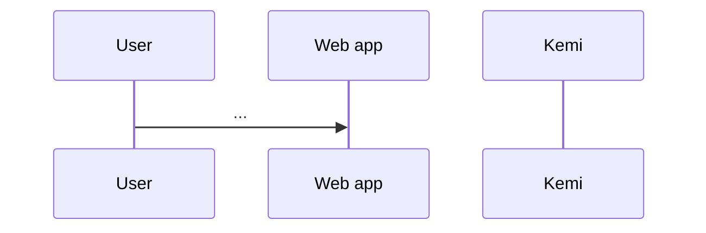

# NNN — <Spec title>: design

Status: Draft
Implements: [requirements.md](requirements.md) · ADRs: <links>

## Overview

<The approach in one paragraph.>

## Modules touched

| Module | Layer | Change |
|---|---|---|
| <e.g. memory> | <domain / application / infrastructure / presentation> | <what changes> |

## Contracts

<Zod schemas added or changed in `contracts/`, with version bump notes. Paste the shape or link the file.>

## Data

<Tables, columns, indexes, migrations, Redis keys and TTLs.>

## Flow

## Agent / prompt changes (if any)

- Playbook: <id@version>, what changes
- Tools: <name, input schema, side effects, validation>
- Model profile: <profile name>, why

## Failure modes

| Failure | Behaviour |
|---|---|
| <provider timeout> | <fallback / message to user> |

## Testing and evals

- Unit: <what>
- Contract / integration: <what>
- Evals: <suite, cases added>

## Rollout

<Feature flag, migration order, backfill, rollback.>
